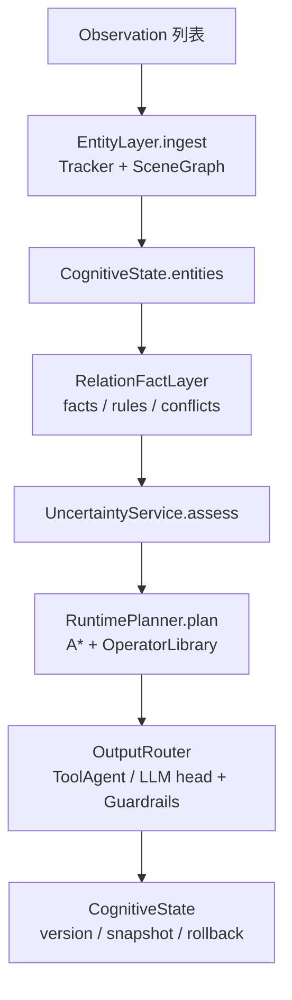
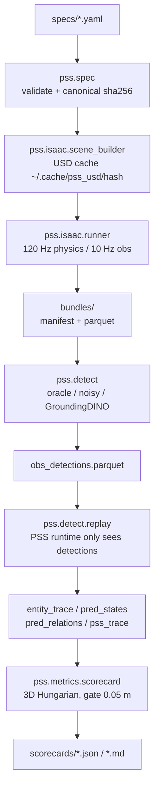

# PSS 项目地图（目录结构 + 核心代码）

> 面向第一次读这个仓库的人。目标是回答三个问题：
> 1. 代码分几层，各自负责什么；
> 2. 一次实验从 spec 到 scorecard 是怎么流动的；
> 3. 想改某个能力时应该看哪些文件。

---

## 1. 四层结构

| 层 | 目录 | 职责 |
|---|---|---|
| 感知前端 | `pss/contracts`、`pss/encoders`、`pss/projection`、`pss/prototypes`、`pss/binding` | 多模态专家 → 128 维公共空间 → 原型识别 |
| 认知运行时 | `pss/runtime`、`pss/memory`、`pss/knowledge`、`pss/reasoning`、`pss/world_model`、`pss/safety`、`pss/heads` | 实体/关系/事实/不确定性/规划/输出 |
| 评测平台 | `pss/spec`、`pss/isaac`、`pss/detect`、`pss/baselines`、`pss/metrics`、`pss/eval` | spec → USD → bundle → 检测 → 回放 → 指标 |
| 数据与实验 | `pss/sim`、`pss/rd2`、`pss/demos`、`scripts`、`specs`、`bundles`、`scorecards`、`freeze` | 仿真数据、真实数据 schema、实验入口、结果归档 |

历史阶段报告（`PHASE*_REPORT.md`）不是运行入口，读代码时可以跳过。

---

## 2. 顶层目录

```text
PublicSemanticSpace/
├── pss/                     核心 Python 包
│   ├── contracts/           公共空间数据契约（Entity/Relation/Prototype，128 维）
│   ├── binding/             Hadamard 绑定/解绑、HRR 对照
│   ├── encoders/            视觉/触觉/几何专家（SmallCNN、DINOv2、WT-MM…）
│   ├── projection/          每模态 → 128 维公共空间的投影头
│   ├── prototypes/          原型库、原型树、四级检索
│   ├── memory/              场景图、追踪、工作记忆、learned re-ID、typed relations
│   ├── runtime/             PSS 认知运行时（状态、层、服务、变体）
│   ├── knowledge/           多源事实库 + 规则引擎
│   ├── reasoning/           关系记录、A* 规划、接触/几何关系
│   ├── world_model/         动作算子库、解析/学习世界模型
│   ├── relations/           评测用几何关系 GT（left_of/right_of/inside…）
│   ├── safety/              护栏、审计、校准、降级
│   ├── heads/               动作/文本/价值读出头
│   ├── spec/                WorldSpec YAML 校验、哈希、注册
│   ├── isaac/               Isaac Sim 场景编译、仿真循环、技能、故障、bundle
│   ├── detect/              oracle/noisy/GroundingDINO 检测、PSS replay
│   ├── baselines/           B1 text-state、B2 SORT-lite
│   ├── metrics/             IDF1、关系 F1、记忆、校准、成本、scorecard
│   ├── eval/                统一评测 suite 与 benchmark 适配器
│   ├── sim/                 MuJoCo 桌面数据生成（早期管线）
│   ├── rd2/                 真实同步数据 schema（目前是 mock）
│   └── demos/               Phase 0 的三个演示
├── specs/                   世界 spec（S1/S2/S3/S4/S6、双物体任务）
├── scripts/                 实际跑实验的入口脚本
├── tests/                   93 个测试文件
├── bundles/                 仿真产生的 episode bundle（数据产物）
├── scorecards/              聚合后的评测结果
├── reports/                 A10 报告归档
├── freeze/                  各阶段冻结配置/哈希
├── contracts/               expert 配置与契约说明
├── bench/                   绑定稳定性等基准
├── _external/               G1 USD、GroundingDINO/DINOv2 权重（gitignore）
├── data/ checkpoints/       数据集与训练权重（gitignore）
└── PHASE*_REPORT.md         历史阶段报告
```

---

## 3. 两条核心数据流

### 3.1 认知运行时（PSS 本体）



对应代码：

- `pss/runtime/state.py`：`Entity / Relation / Fact / Goal / Plan / CognitiveState`。
- `pss/runtime/runtime.py`：`PSSRuntime`，唯一的状态所有者；`ingest / assert_fact / set_goal / plan / explain / act / rollback` 都走 `_commit` 审计。
- `pss/runtime/layers.py`：`EntityLayer` 和 `RelationFactLayer`，负责“感知 → 符号”。
- `pss/runtime/services.py`：`UncertaintyService`、`RuntimePlanner`。
- `pss/runtime/operators.py`：`VersionedOperatorLibrary`。
- `pss/runtime/variants.py`：9 个消融变体 + `NoMemoryEntityLayer`，`build_runtime()` 是实验入口。

### 3.2 Isaac 评测平台



关键约束：

- `obs` 和 `gt` 是两条独立通道（`pss/isaac/bus.py`），PSS replay 不打开 `gt.parquet`。
- spec 的 canonical sha256 是 USD 缓存、bundle、scorecard 的主键。
- bundle 是评测原子：仿真只写 parquet，指标离线读。

---

## 4. 核心模块

### 4.1 公共空间前端

| 文件 | 内容 |
|---|---|
| `pss/contracts/schema.py` | `PUBLIC_DIM=128`、`SLOT_COUNT=4`、`BINDING_SCHEME="hadamard"`；`Entity.bound` 是临时工作记忆表示，`raw` 是持久表示 |
| `pss/binding/ops.py` | `bind` = Hadamard 乘；`unbind` = 带符号保持的近零保护除法 |
| `pss/binding/hrr.py` | HRR 对照实现（未采用） |
| `pss/encoders/registry.py` | 统一 `encode(x) -> (B, d)`；视觉 smallcnn/dinov2/clip，触觉 mlp/conv/wtmm |
| `pss/projection/heads.py` | 每模态投影头：PCA whitening + residual skip + L2 normalize |
| `pss/prototypes/bank.py` | 按模态分开存的原型库 |
| `pss/prototypes/tree.py` | 数据驱动的层次原型树 |
| `pss/prototypes/recognize.py` | 四级检索：场景候选 → 模态掩码 → ANN top-k → 精确 cosine 融合 |

### 4.2 记忆与身份

| 文件 | 内容 |
|---|---|
| `pss/memory/scene_graph/__init__.py` | `Track` + `SceneGraph`；持久实体、生命周期、网格空间索引 |
| `pss/memory/tracking.py` | `TrackerConfig` + `Tracker.step`；匈牙利匹配、生命周期、re-ID |
| `pss/memory/active_policy.py` | `ActiveSetPolicy`（该关注谁）、`WritePolicy`（该不该写） |
| `pss/memory/learned_metric.py` | Siamese `MetricEmbedding`，学习型 re-ID 度量 |
| `pss/memory/typed_relations.py` | 学习型关系边：spatial/semantic/tactile/temporal/task |
| `pss/memory/perception.py` | `Observation` 数据结构与从仿真帧抽取观测 |

核心不变量：**槽 ≠ 身份**。`SceneGraph` 拥有身份，`active_ids()` 只是工作记忆视图，淘汰不删除实体。

### 4.3 符号、事实与规划

| 文件 | 内容 |
|---|---|
| `pss/relations/__init__.py` | 评测用精确几何谓词：`left_of`（x 更小）、`right_of`、`in_front_of`、`behind`、`above`、`below`、`on_top_of`、`inside`、`touching`、`near` |
| `pss/reasoning/relations/__init__.py` | `RelationRecord` + `RelationStore`；几何/属性关系 |
| `pss/knowledge/facts.py` | `FactStore`（版本/历史/审计）、`MultiSourceFactStore`（多源断言）、`RuleEngine` |
| `pss/world_model/actions.py` | `Operator(name, preconditions, add, remove, cost)`；`laundry_library()` 示例 |
| `pss/reasoning/planner/__init__.py` | `AStarPlanner`：状态是 `frozenset` of facts，启发式是缺失目标事实数 |
| `pss/runtime/services.py` | `RuntimePlanner` 把 `CognitiveState.fact_set()` 喂给 A*；`UncertaintyService` 输出 accept/review/abstain |

### 4.4 感知检测与基线

| 文件 | 内容 |
|---|---|
| `pss/detect/oracle.py` | GT box 投影成检测，只用于校准 |
| `pss/detect/noise.py` | miss rate、位姿噪声、误检、类别混淆 |
| `pss/detect/groundingdino.py` | GroundingDINO tiny + DINOv2-small appearance；深度/平面反投影；NMS |
| `pss/detect/replay.py` | PSS 只读 detections，逐帧 ingest，写 trace |
| `pss/detect/session_replay.py` | S6 连续 session，一个 runtime 跨 sub-episode |
| `pss/baselines/trackers.py` | B1 text-state、B2 SORT-lite |

### 4.5 Isaac 平台

| 文件 | 内容 |
|---|---|
| `pss/spec/schema.py` | YAML 校验；`canonical_json` + `hash_spec` |
| `pss/isaac/scene_builder.py` | spec → USD，缓存 `~/.cache/pss_usd/<hash>/`，记录 prim-tree hash |
| `pss/isaac/runner.py` | 120 Hz 物理、10 Hz 观测；相机轨迹、遮挡、故障、GT、bundle |
| `pss/isaac/bus.py` | obs/gt 两个 ZMQ 端点，进程级 GT 防火墙 |
| `pss/isaac/bundle.py` | bundle parquet schema 与写入 |
| `pss/isaac/skills.py` | G1 右臂 IK + suction proxy 抓取；`base_fixed` |
| `pss/isaac/faults.py` | 10 类故障注入 |
| `pss/isaac/verify.py` | bundle 读回检查（含“可见度必须变化”断言） |

### 4.6 指标

| 文件 | 指标 |
|---|---|
| `pss/metrics/entity.py` | IDF1、retention、switches、duplicate、reappearance、slot purity |
| `pss/metrics/relation.py` | 逐谓词 F1、逆关系/传递一致性违规 |
| `pss/metrics/twin.py` | 双胞胎歧义 |
| `pss/metrics/memory.py` | edited accuracy、old forgetting、ID retention、rollback exactness |
| `pss/metrics/calibration.py` | ECE、可靠性曲线 |
| `pss/metrics/cost.py` | 从 `pss_trace` 统计调用/延迟/成本 |
| `pss/metrics/scorecard.py` | bundle → 指标 → scorecard；3D Hungarian gate 0.05 m |
| `pss/metrics/report.py` | bundle index、复算、A10 报告 |

---

## 5. 实验入口

| 目标 | 命令/脚本 |
|---|---|
| 单 episode 仿真 | `pss sim run specs/s1_occlusion.yaml --episodes 1 --seed 0` |
| 编译 USD | `pss sim build specs/s1_occlusion.yaml` |
| oracle 检测 | `pss detect --tier oracle --bundle ...` |
| 真实检测 | `pss detect --tier frozen_real --bundle ...` |
| PSS 回放 | `pss replay --bundle ...` |
| 聚合指标 | `pss score --suite s1_occlusion` |
| 基础抓放 | `scripts/run_s4_pss.py` |
| 关系选目标 | `scripts/run_s4_pss.py --spec specs/s4_pss_relation.yaml --selection relation_left_of` |
| 遮挡+改位记忆 | `scripts/run_s4_pss_memory.py` |
| 双物体双箱 | `scripts/run_s4_pss_two.py` |
| 汇总 S4-PSS | `scripts/score_s4_pss.py` |
| S1 基线 | `scripts/run_s1_baselines.py` |

顶层路由在 `pss/cli.py`：`spec / sim / detect / replay / score / score-relations / report / verify-recompute`。

---

## 6. 重要实现约束

1. **GT 防火墙**：`pss/isaac/bus.py` 把 obs/gt 分成两个端点；`pss/detect/replay.py` 只读 `obs_detections.parquet`。
2. **spec 哈希是主键**：canonical JSON → sha256，USD 缓存、bundle、scorecard 都用它。
3. **bundle 是评测原子**：仿真只写 parquet，指标离线读。
4. **槽 ≠ 身份**：`SceneGraph` 拥有身份，`active_ids()` 只是工作记忆视图。
5. **事实与规则分离**：facts 可版本化/回滚，rules 单独版本化。
6. **消融靠 runtime 变体**：`build_runtime(variant)` 不改变场景和 bundle，只换层实现。
7. **两套 Python 环境**：PSS 3.13（`D:\Python`），Isaac 3.11（`D:\isaac\env`）；`pxr`/`isaacsim`/`torch` 都是懒加载。

---

## 7. 建议阅读顺序

1. `pss/contracts/schema.py` + `pss/runtime/state.py`：数据模型。
2. `pss/runtime/runtime.py` + `layers.py` + `services.py`：状态怎么流动。
3. `pss/memory/scene_graph/__init__.py` + `tracking.py`：身份怎么保持。
4. `pss/reasoning/relations` + `knowledge/facts.py` + `planner`：符号和规划。
5. `pss/spec/schema.py` + `pss/isaac/runner.py` + `pss/detect/replay.py`：评测平台。
6. `pss/metrics/scorecard.py` + `scripts/run_s4_pss*.py`：结果怎么产生。

---

## 8. 结果与产物

| 路径 | 内容 |
|---|---|
| `bundles/<device>/<suite>/<hash8>/seed<N>/` | 单 episode 的 manifest + parquet |
| `scorecards/` | 聚合后的 suite 指标（JSON + Markdown） |
| `reports/<tag>/` | A10 报告归档 |
| `freeze/` | 各阶段冻结配置/哈希 |
| `notes/` | 关键实验结论与失败归因 |
| `eval/results/` | 评测结果（部分 gitignore） |
