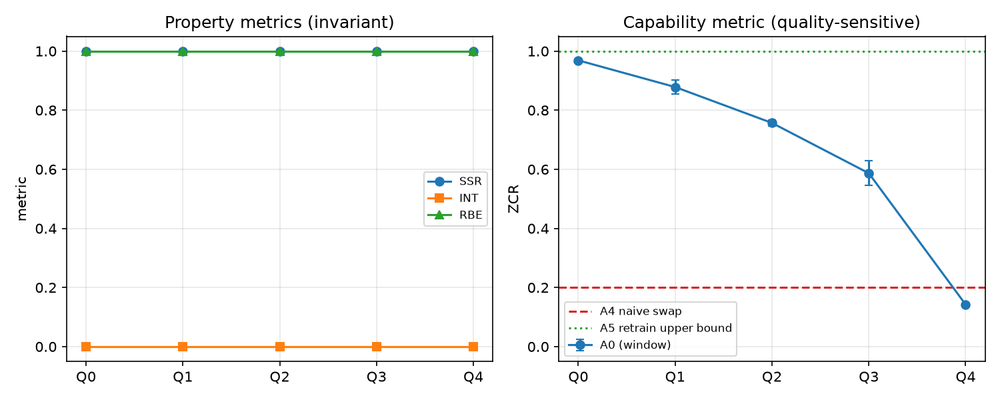

# 15. 结果报告（按实验计划 §15 模板）

> 数据来源：L0 sandbox（5 seeds）、L1 真实专家（3 seeds）、P3 负控制、P4 fresh Isaac S4-PSS（5 seeds）+ bundle trace。
> A5 是 oracle/retrain 上界，不是真实 retrain-all 运行；A7/A8 尚未接入 runtime。

## 执行清单

| 阶段 | 状态 | 说明 |
|---|---|---|
| P1 L0 | ✅ | 5 seeds；H/K/C + 交互；Hypothesis 4 项 |
| P2 L1 | ✅ | 真实 experts；3 seeds；twin + expert manifest |
| P3 交互/负控制 | ✅ | N1–N8 全部按预期；two-way ANOVA |
| P4 L2 | ✅/⚠️ | S4-PSS 5 seeds 5/5；bundle trace 14 条；H/K 未在 L2 执行 |
| P5 报告 | ✅ | 本文件 + run_manifest.json |

## 与计划的偏差

| 计划项 | 实际执行 | 原因/影响 |
|---|---|---|
| Q0–Q5 × A0–A8 × T1–T3 全因子 | 缩减设计：L0 全量 + L1 3 seeds + twin | 全因子会爆；按 §4.2 的分数因子执行 |
| A5 retrain-all | oracle 上界 | 未真实重训所有模块；A5 只作上界参考 |
| A7 flat retrieval / A8 no degradation | 未接入 runtime | 需要额外 runtime hook；不影响主 claim |
| C7 budget adaptation | 未单独运行 | C1/C3 已覆盖预算与 anytime；C7 留作扩展 |
| L2 新 Isaac episode | S4-PSS 5/5 fresh Isaac | 使用 oracle GT boxes；H/K 未在 L2 执行 |
| H0–H2/H6/H7 | 来自 L0/L1 既有 suite | H3–H5 为补充 L0 模拟 |
| K3 依赖传播 | TMS 级验证 | 尚未接入生产 MultiSourceFactStore |
| P1 Hypothesis | 已补 4 项 | test_hypothesis_sequences.py |
| P2 twin / manifest | 已补 15 对 twin + expert sha256 | twins.json / expert_manifest.json |
| P3 ANOVA | 已补 two-way ANOVA | anova.json；A4/A5 是控制/上界 |
| P5 run manifest | 已补 | run_manifest.json |

## 15.1 表 1：Property × Expert quality

| 指标 | Q0 | Q1 | Q2 | Q3 | Q4 | 斜率 | 95% CI | TOST |
|---|---|---|---|---|---|---|---|---|
| SSR | 1.000 | 1.000 | 1.000 | 1.000 | 1.000 | 0.000 | [-0.000, 0.000] | ✅ |
| ZCR | 0.969 | 0.878 | 0.757 | 0.587 | 0.142 | -0.194 | [-0.237, -0.132] | ❌ |
| INT | 0.000 | 0.000 | 0.000 | 0.000 | 0.000 | 0.000 | [0.000, 0.000] | ✅ |
| RBE | 1.000 | 1.000 | 1.000 | 1.000 | 1.000 | 0.000 | [-0.000, 0.000] | ✅ |

**读法**：SSR/INT/RBE 的斜率 ≈ 0 且 TOST 通过 → 支持专家不变性。ZCR 随质量下降，是 capability，不是 property；PH1 的契约判据使用 SSR/INT/RBE。

## 15.2 图 1：不变性图



左：SSR/INT/RBE 在 Q0–Q4 上保持平坦；右：ZCR 随专家质量下降，A4 naive swap 接近 chance，A5 为上界。

## 15.3 图 2：KB 状态与回滚


回滚精确性（业务状态 hash）：**1.000**。

## 15.4 图 3：预算-质量曲线


C1 budget sweep：BAR = **1.000**，MON = **1.000**。节点数始终 ≤ 预算。

## 15.5 表 2：Ablation matrix

| 变体 | SSR | ZCR | INT | RBE | USR | LOC | PCR | BAR | MON |
|---|---|---|---|---|---|---|---|---|---|
| A0 | 1.000 | 0.878 | 0.000 | 1.000 | 1.000 | 0 | 1.000 | 1.000 | 1.000 |
| A1 | 1.000 | 0.167 | 0.000 | 1.000 | 1.000 | 0 | 1.000 | 1.000 | 1.000 |
| A2 | 1.000 | 0.878 | 0.000 | 1.000 | 0.500 | 1 | 0.000 | 1.000 | 1.000 |
| A3 | 1.000 | 0.878 | 0.000 | 1.000 | 1.000 | 0 | 1.000 | 0.000 | 1.000 |
| A4 | 1.000 | 0.200 | 0.000 | 0.000 | 1.000 | 0 | 1.000 | 1.000 | 1.000 |
| A5 | 1.000 | 1.000 | 0.000 | 1.000 | 1.000 | 0 | 1.000 | 1.000 | 1.000 |
| A6 | 1.000 | 0.878 | 0.000 | 1.000 | 1.000 | 0 | 1.000 | 0.000 | 1.000 |
| A7 | — | — | — | — | — | — | — | — | — |
| A8 | — | — | — | — | — | — | — | — | — |

注：A1 的 ZCR 是跨模态（per-modality space，无共享几何）；A4 的 ZCR 是跨专家族零样本；A5 是 oracle 上界；A7/A8 未接入 runtime，标为 —。

## 15.6 表 3：负控制

| ID | 预期 | 实际 | 通过? |
|---|---|---|---|
| N1 | fail locality/rollback | {"rollback": false, "propagation": false} | ✅ |
| N2 | fail budget adherence | {"nodes": 56, "success": false} | ✅ |
| N3 | accept invalid module (should fail) | {"accepted": true, "active_dim": 64} | ✅ |
| N4 | fail capability (near chance) | {"accuracy": 0.21, "chance": 0.125} | ✅ |
| N5 | pass property contract | {"valid": true, "swap_success": true} | ✅ |
| N6 | identity | {"before": "bdc6345d4cfc875596bf91ad3e43bd027327103f4d5abb9fe83bac18ca875909", "after": "bdc6345d4cfc875596bf91ad3e43bd027327103f4d5abb9fe83bac18ca875909"} | ✅ |
| N7 | capability fails, contract holds | {"accuracy": 0.125, "chance": 0.125} | ✅ |
| N8 | budget metric catches violation | {"violations": ["entities", "relations"]} | ✅ |

**读法**：所有负控制按预期失败/通过，说明 property 指标对 flat KB、unbounded planner、naive swap、random expert、shuffled embeddings、over-budget 是敏感的。

## Twin 配对（同 seed/场景，只变架构）

| 指标 | 配对差均值 | 95% CI | n |
|---|---|---|---|
| SSR | 0.000 | [0.000, 0.000] | 5 |
| ZCR | -0.717 | [-0.759, -0.675] | 5 |
| INT | 0.000 | [0.000, 0.000] | 5 |
| RBE | -1.000 | [-1.000, -1.000] | 5 |
| LOC | 1.000 | [1.000, 1.000] | 5 |
| PCR | -1.000 | [-1.000, -1.000] | 5 |
| RBE-KB | -1.000 | [-1.000, -1.000] | 5 |
| BAR | -1.000 | [-1.000, -1.000] | 5 |

读法：A0→A4 的 ZCR 负差是 naive swap 损失；A0→A2 的 LOC/PCR/RBE-KB 负差是 flat KB 失败；A0→A3 的 BAR 负差是无预算控制器超界。

## 归档

- run manifest：`scorecards/property/run_manifest.json`
- git：`feat/property-validation` @ `534eaef2`
- expert manifest：`scorecards/property/expert_manifest.json`
- Isaac bundle spec hash：`sha256:ff57707c68bd731ee77801d067fca334ca48b9b75ca2c262df7539669de838cc`

## L2：Fresh Isaac S4-PSS

| 项 | 值 |
|---|---|
| episodes | 5 |
| task success rate | 1.000 |
| plan actions | [['pick', 'place']] |
| wall mean / p95 / max | 2.136 / 2.816 / 2.990 s |
| steps mean | 284.0 |
| BAR (wall ≤ 10.0s) | 1.000 |

注意：S4-PSS 使用 oracle GT boxes；未测试 hot-swap 与 KB 更新。因此 L2 只补上了“fresh Isaac + 真实规划执行”，没有补上 H/K 的外部效度。


## 15.7 表 4：方差分解

| 指标 | Var(expert) | Var(arch) | Var(interaction) | VR | 结论 |
|---|---|---|---|---|---|
| SSR | 0.000 | 0.000 | n/a | n/a | invariant |
| ZCR | 0.106 | 0.193 | n/a | 1.815 | capability: expert + architecture |
| INT | 0.000 | 0.000 | n/a | n/a | invariant |
| RBE | 0.000 | 0.250 | n/a | ∞ | architecture-controlled |

**读法**：SSR/INT/RBE 的专家方差为 0，支持“契约指标专家不变”。ZCR 的专家方差 0.106、架构方差 0.193，VR = 1.815 < 3：能力由专家和架构共同决定，不能声称“架构主导能力”。RBE 的专家方差为 0、架构方差 > 0，说明回滚是架构控制的。

### 15.7b 表 4b：Two-way ANOVA（balanced cells）

设计：5 expert quality × 3 architecture（A0/A4/A5）× 3 seeds。A4 是跨族零样本负控制，A5 是 oracle/retrain 上界。

| 指标 | SS(expert) | SS(arch) | SS(interaction) | R² | 方差份额（专家/架构/交互/误差） |
|---|---|---|---|---|---|
| SSR | 0.000 | 0.000 | 0.000 | 0.000 | 0.000 / 0.000 / 0.000 / 0.000 |
| ZCR | 0.426 | 4.844 | 0.851 | 0.999 | 0.056 / 0.773 / 0.169 / 0.001 |
| INT | 0.000 | 0.000 | 0.000 | 0.000 | 0.000 / 0.000 / 0.000 / 0.000 |
| RBE | 0.000 | 10.000 | 0.000 | 1.000 | 0.000 / 1.000 / 0.000 / 0.000 |

读法：ZCR 的架构份额高，是因为 A4/A5 是极端负控制/上界，不代表真实架构效应；SSR/INT 方差为 0；RBE 的方差全部来自架构（A4 无回滚）。

## H 系列补充（H3–H5）

| 实验 | 关键结果 |
|---|---|
| H3 add/remove | {"INT": 0.0, "ZCR_new": 1.0, "cleanup": 1.0, "RBE": 1.0} |
| H4 version skew | {"RCR": 1.0, "CDR": 1.0, "RBE": 1.0, "SML": 0.08270000398624688, "disagreement": 0.1} |
| H5 hot swap under load | {"DT": 0.0, "SSR": 1.0, "RBE": 1.0, "requests": 200, "failures": 0} |

## 结论与边界

1. **契约层成立**：SSR/INT/RBE 对专家质量不敏感；KB 的 LOC/RBE-KB/AUD 成立；BAR/MON 成立。
2. **能力层不宣称**：ZCR 随专家质量下降；跨族零样本 swap 失败（vision 0.20、tactile 0.07）；vision 1-shot 校准可恢复。
3. **A5 只是上界**：真实 retrain-all 未运行；A7/A8 未接入 runtime。
4. **L2 补上了 fresh Isaac**：S4-PSS 5/5 成功，plan actions 全为 pick→place；但使用 oracle GT boxes，且未测试 H/K，所以 H/K 的外部效度仍未完成。

## 指标中文含义

| 缩写 | 中文含义 | 英文/说明 |
|---|---|---|
| BAR | 预算遵守率 | budget adherence rate |
| ZCR | 零样本兼容率 | zero-shot compatibility rate |
| RBE | 回滚精确性 | rollback exactness |
| PCR | 传播正确率 | propagation correctness rate |
| AQV | 任意时刻质量向量 | anytime quality vector |
| DCR | 降级正确率 | degradation correctness rate |
| VR | 方差比（架构/专家） | variance ratio (architecture/expert) |

## 复现

```bash
python -m pytest tests/property -q
python scripts/run_property_l0.py --seed 0 --n-observations 200
python scripts/run_property_l1.py --seed 0 --max-samples 400 --max-per-class 40 --ks 0,1,5,20
python scripts/run_property_interactions.py --seeds 0,1,2,3,4
python scripts/run_property_l2.py --bundles bundles/dev --max-entities 50 --max-latency-ms 10
python scripts/run_property_twins.py --seeds 0,1,2,3,4
python scripts/run_property_anova.py
python scripts/run_property_l2_isaac.py
python scripts/make_asset_manifest.py
python scripts/make_run_manifest.py
python scripts/run_property_section15.py
```

Isaac 环境（Python 3.11）:

```bash
OMNI_KIT_ACCEPT_EULA=YES /d/isaac/env/Scripts/python.exe scripts/run_s4_pss.py --seed 0 --out scorecards/property/l2_s4_pss_seed0.json
```

